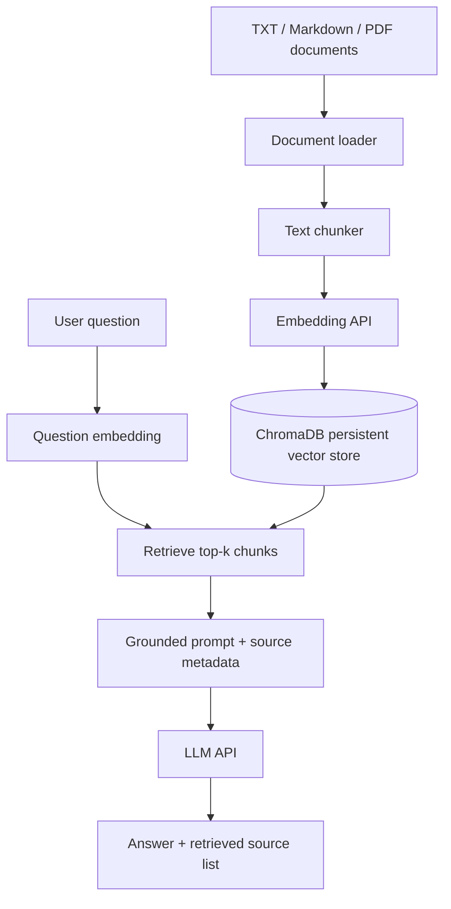

# RAG Document Question Answering with Python

A practical Retrieval-Augmented Generation (RAG) example that answers questions using your own TXT, Markdown, and PDF documents. It uses OpenAI embeddings, ChromaDB for vector search, and an LLM API to generate responses grounded in retrieved passages.

> **Cost and privacy:** Embedding and answer-generation calls use a hosted API and may incur charges. Document chunks and questions are sent to the configured provider. Use only documents you are permitted to process, and never commit credentials or private data.

## What this project demonstrates

1. Load text, Markdown, and PDF documents.
2. Split content into overlapping word-based chunks.
3. Create embeddings for document chunks.
4. Persist embeddings and metadata in ChromaDB.
5. Embed a question and retrieve similar chunks.
6. Build a grounded prompt that asks the model not to guess beyond retrieved context.
7. Return an answer and the filenames of the retrieved sources.
8. Run unit tests and GitHub Actions CI.

## Architecture



## Project structure

```text
rag-document-qa-python/
├── src/rag_app/
│   ├── config.py             # Environment-based configuration
│   ├── document_loader.py    # TXT, Markdown, and PDF loading
│   ├── chunker.py            # Overlapping word-based chunks
│   ├── embeddings.py         # Embedding API client
│   ├── vector_store.py       # Persistent ChromaDB store
│   ├── retriever.py          # Retrieved chunk and metadata model
│   ├── prompt_builder.py     # Context-grounded prompt construction
│   ├── llm_client.py         # Answer-generation API client
│   ├── rag_pipeline.py       # Ingestion and question-answering flow
│   └── cli.py                # `ingest` and `ask` commands
├── data/sample_docs/         # Synthetic EKS/Kubernetes notes
├── examples/sample_questions.txt
├── tests/
├── .env.example
├── .github/workflows/python-tests.yml
├── pyproject.toml
├── requirements.txt
└── README.md
```

## Prerequisites

- Python 3.11 or newer
- An API key with access to the selected generation and embedding models
- Git (optional, to clone this repository)

## Quick start

### 1. Clone the repository

```bash
git clone https://github.com/vicky123444/rag-document-qa-python.git
cd rag-document-qa-python
```

### 2. Create a virtual environment

**Windows PowerShell**

```powershell
py -3.11 -m venv .venv
.\.venv\Scripts\Activate.ps1
```

If PowerShell activation is blocked, use Command Prompt: `.venv\Scripts\activate.bat`.

**macOS / Linux**

```bash
python3 -m venv .venv
source .venv/bin/activate
```

### 3. Install dependencies

```bash
python -m pip install --upgrade pip
pip install -r requirements.txt
pip install -e .
```

### 4. Configure your API key

Copy `.env.example` to `.env`.

Windows PowerShell:

```powershell
Copy-Item .env.example .env
```

macOS / Linux:

```bash
cp .env.example .env
```

Update `.env` with your actual key and model settings:

```dotenv
OPENAI_API_KEY=your-api-key-here
OPENAI_MODEL=gpt-4o-mini
EMBEDDING_MODEL=text-embedding-3-small
CHROMA_PERSIST_DIRECTORY=data/chroma
COLLECTION_NAME=rag_document_qa
```

Confirm model availability and pricing for your own API account. Never commit `.env`; the repository ignores it.

### 5. Index the sample documents

```bash
python -m rag_app.cli ingest --source data/sample_docs
```

The application reads the supported files, splits their text into chunks, generates embeddings, and stores them in a local persistent ChromaDB collection. Indexing makes API calls and may incur charges.

### 6. Ask a question

```bash
python -m rag_app.cli ask "How do I investigate a pod in CrashLoopBackOff?"
```

Expected behavior: the application retrieves relevant passages, sends those passages with the question to the model, prints the generated answer, and lists the filenames returned by retrieval. Exact answers vary by documents and model.

## Configuration options

| Variable | Purpose | Default |
|---|---|---|
| `OPENAI_API_KEY` | API credential | Required for API calls |
| `OPENAI_MODEL` | Answer generation model | `gpt-4o-mini` |
| `EMBEDDING_MODEL` | Embedding model | `text-embedding-3-small` |
| `CHROMA_PERSIST_DIRECTORY` | Local vector database path | `data/chroma` |
| `COLLECTION_NAME` | Chroma collection | `rag_document_qa` |
| `CHUNK_SIZE` | Maximum words per chunk | `800` |
| `CHUNK_OVERLAP` | Overlap between chunks in words | `120` |
| `TOP_K` | Number of chunks retrieved | `4` |

The chunker uses **words**, not tokenizer tokens. These values are learning defaults rather than universal optimal settings. Tune them based on retrieval tests for your documents.

## Run tests

```bash
pytest
```

Unit tests use fakes and mocks for core pipeline behavior; they should not require a live API key. The CI workflow installs dependencies and runs tests on pushes to `main`/`master` and pull requests.

## Limitations and production considerations

- Retrieval quality depends on document quality, chunk boundaries, embeddings, and query relevance.
- The prompt asks the model to answer from context, but prompts cannot guarantee factual correctness. Evaluate answers and retrieval with representative questions.
- The displayed source list represents retrieved source files; it does not independently prove that every sentence is supported by each file.
- PDF text extraction can fail for scanned/image-only PDFs; OCR is not included.
- The example searches only files directly inside the specified directory; it does not recursively traverse nested directories.
- Re-indexing adds new chunks to the existing collection. For repeatable production ingestion, design document IDs, deletion/update behavior, and deduplication explicitly.
- Apply document-level authorization before retrieval in multi-user systems. Do not expose all indexed documents to every user by default.
- Treat retrieved documents as untrusted input; they can contain misleading instructions or prompt-injection attempts. The LLM should not directly execute commands or privileged actions.
- Hosted embedding and generation calls transmit input text to the configured provider. Review your data handling and provider terms before using confidential documents.
- Add token/cost budgets, rate limiting, observability, backoff, and robust evaluation before production deployment.

## Troubleshooting

- **API authentication error:** verify the API key and model access.
- **No relevant answer:** confirm indexing completed and test with questions covered by the sample docs.
- **Chroma collection problems:** back up data first; for a clean learning run, stop the app and remove the local `data/chroma` directory before indexing again.
- **PDF contains no text:** the current loader relies on text extraction; scanned PDFs require an OCR step not included here.

## License

MIT. See [LICENSE](LICENSE).

## Article companion

This repository accompanies the *Vikram Tech Lab* article **“RAG Explained: How AI Uses Your Own Documents and Data.”**
